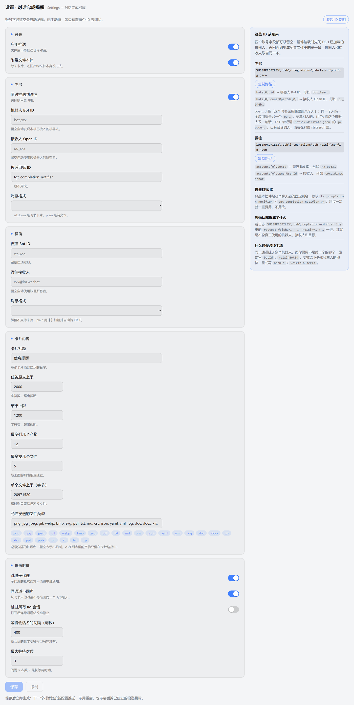

# dsh-conversation-completion-reminder

Send a Feishu (Lark) or WeChat card **when a DSH conversation turn finishes** — which entry point it came from, which turn, the folder it ran in, the task, the result, and the files it produced.

A long turn usually finishes while you are looking at something else, and refreshing the chat list by hand rarely catches it. This bundle makes the result come to you.

简体中文 · [README.md](README.md)

## What a card looks like

```
🔔 信息提醒
---
💬 来自 飞书 · 信息提醒
🕒 16:03 · 用时 3分42秒
🗂 会话 重构支付回调的重试逻辑
🔁 第 4 轮 · ✅ 完成
📁 E:\work\pay

📝 任务
把支付回调的重试逻辑改成指数退避，并补一个超时用例

💬 结果
已完成。重试封装进 src/pay/retry.ts，退避上限 30 秒……

📦 产物 2 个
1. retry.ts · 4.1 KB
   E:\work\pay\src\pay
2. retry.md · 812 B
   E:\work\pay\docs
```

Feishu gets this as a markdown card; WeChat gets the plain-text equivalent (CRLF, because iLink renders bare LF as one long line).

## The settings page

Once installed, the left **Settings** page grows this block — five form groups, with the ID cheat-sheet in the drawer on the right:



The dark theme uses the same controls: [`assets/screenshot-settings-dark.png`](assets/screenshot-settings-dark.png).

## What it does

- **Host half** (`index.js`) watches turn completions (`completed`, `error`, `max-tokens` by default), renders the card above, and delivers it through `dsh-feishu` / `dsh-weixin` — the same bot that already talks to you.
- **Client half** (`client.js`) adds a **对话完成提醒** section to the left **Settings** page with five form groups: 开关 / 飞书 / 微信 / 卡片内容 / 推送时机.
- Nothing leaves your machine except the card, which goes through the IM bot you connected yourself.

## Requirements

- DSH desktop **0.2.2-rc.1 ≤ version < 0.3.0-0** (`engines.dsh`).
- At least one connected integration under **Integrations → Feishu / WeChat**. With no bot connected the plugin stays enabled but every delivery is skipped with a reason in the trace log.

## Install

```powershell
dsh plugin --profile desktop add dsh-conversation-completion-reminder
```

Or, from the app: **Settings → Plugins → Add plugin**, paste the package name, then enable the `completion-notifier` row and reload the window once.

The bundle's patch inserts the row with `config: {}` — auto-discovery is the default, so it works before you configure anything.

## Quick start

1. Install, enable the row, reload the window.
2. Open **Settings → 对话完成提醒** and leave the ID fields empty (auto-discovery = a private chat with the bot's own owner).
3. Run a longer turn in any conversation.
4. The card should arrive. If it does not, read the log at `tracePath`: every delivery decision writes one line with its reason.

## Configuration

Open **Settings → 对话完成提醒**. Leave the ID fields empty and the plugin discovers the bot from `ctx.dshIm.listBots()` and the recipient from that bot's own integration config (its owner). Fill them in to pin one specific chat.

| Field | Default | Meaning |
| --- | --- | --- |
| `enabled` | `true` | Master switch for delivery |
| `botId` / `openId` | `''` (discover) | Feishu bot and receiver |
| `targetId` | `tgt_completion_notifier` | Delivery target key for Feishu |
| `format` | `markdown` | Feishu card body format (`markdown` / `plain`) |
| `weixinEnabled` | `true` | Also push to WeChat |
| `weixinBotId` / `weixinToUserId` | `''` (discover) | WeChat account and receiver |
| `weixinFormat` | `plain` | WeChat body format |
| `cardTitle` | `信息提醒` | Header printed on every card |
| `maxTaskChars` | `2000` | Task text budget |
| `maxAnswerChars` | `1200` | Answer text budget |
| `maxArtifacts` | `12` | How many artifact paths are listed |
| `attachFiles` | `true` | Upload the artifacts themselves, not just paths |
| `maxAttachments` | `5` | Per-run upload cap |
| `maxAttachBytes` | `20971520` | Larger files are reported by path only |
| `attachTypes` | `png jpg jpeg gif webp bmp svg pdf txt md csv json yaml yml log doc docx xls xlsx ppt pptx zip 7z tar gz` | Which extensions may be uploaded; an **empty list means no filtering** |
| `titleWaitMs` / `titleWaitSteps` | `400` / `3` | Short wait for the session title to land |
| `skipSubagents` | `true` | Do not report subagent turns |
| `skipSameChannel` | `true` | Do not report a turn back into the chat that just spoke |
| `skipImSessions` | `false` | Drop every IM-originated conversation |
| `skipSessionIds` | `[]` | Session ids to ignore |
| `notifyOn` | `completed, error, max-tokens` | Which turn outcomes produce a card |
| `tracePath` | `$DSH_HOME/completion-notifier.log` | Delivery trail, one line per decision |

### About the receiver IDs

`open_id` is **scoped per Feishu app**: the same person has a different `ou_…` in every bot. DSH learns it when that person messages the bot, and records it as `p2p:<open_id>` in `%USERPROFILE%\.dsh\integrations\dsh-feishu\bots\<bot_id>\state.json`. To push to somebody else, either have them send one message to the bot first, or resolve their ID with `POST /open-apis/contact/v3/users/batch_get_id` (needs contact permission and app availability). An ID copied from another bot's config will not work.

## Troubleshooting

**WeChat never arrives.** iLink refuses a chat that has gone quiet (`delivery-failed`: the chat needs a fresh message from the recipient). Send the bot one message and the next card goes through.

**Too noisy.** Narrow `notifyOn` to `completed` only, keep `skipSubagents` on, or turn on `skipImSessions`. `skipSameChannel` already stops a card from being pushed back into the chat that just spoke.

**Don't want file uploads.** Turn `attachFiles` off, or lower `maxAttachments` / `maxAttachBytes`.

**Only certain artifact types.** Edit `attachTypes` (comma-separated extensions); leave it empty for no filtering.

**Several bots connected.** Discovery takes the first loaded one; pin `botId` to choose.

## Uninstall

Disable or remove the `completion-notifier` row in **Settings → Plugins**. The settings values live in the profile's patch and survive the removal.

## More

- [docs/DETAIL.md](docs/DETAIL.md) — implementation notes, field semantics, delivery path.
- [docs/PUBLISH.md](docs/PUBLISH.md) — npm publish, catalog listing, self-hosted index.

## License

MIT
